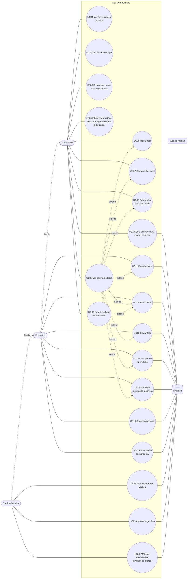

# Diagrama de Casos de Uso — VerdeUrbano (Unidade II)

Atende ao item **b) i**. Atualizado com as regras de negócio implementadas no app e no
`app/firestore.rules`. O diagrama está em Mermaid (o GitHub desenha automaticamente).

> ⚠️ **Pendente:** incluir as regras do **aditivo de regras de negócio** do estudo de caso
> quando o grupo recebê-lo. As regras abaixo vêm do estudo de caso, dos requisitos e da modelagem.

## Atores

| Ator | Quem é |
|---|---|
| **Visitante** | Qualquer pessoa usando o app **sem conta** (RNF03). |
| **Usuário** | Visitante que entrou com e-mail e senha (Firebase Auth). Faz tudo o que o visitante faz. |
| **Administrador** | Usuário com `papel = admin` no Firestore (dado só pelo console). Faz tudo o que o usuário faz. |
| **Firebase** (sistema) | Autenticação e banco de dados (Cloud Firestore). |
| **App de mapas** (sistema) | App de navegação do aparelho, aberto pela tela Rota. |

## Diagrama

## Regras de negócio

| Código | Regra | Onde é garantida |
|---|---|---|
| RN01 | Mapa, busca, página do local, rota e diário funcionam **sem conta** (RNF03). | `areas_verdes` com leitura pública; `ShellTela` |
| RN02 | Favoritar, avaliar, enviar foto, criar evento, sinalizar e sugerir local **exigem login**. O app abre o login e volta para a ação. | `garantirLogin()` em `core/navegacao.dart` + regras |
| RN03 | **Uma avaliação por pessoa por local**: o id da avaliação é o uid do autor. Avaliar de novo edita a anterior. | `AvaliacoesRepositorio`, `firestore.rules` |
| RN04 | Notas de **1 a 5** em 4 critérios; comentário até 500 caracteres. | `CampoEstrelas`, `AvaliacoesRepositorio.validar`, regras |
| RN05 | A média do local é atualizada **na mesma transação** da avaliação (criar, editar, excluir). O banco recusa resumo que não bate. | `AvaliacoesRepositorio.salvar/excluir`, `resumoCoerente()` |
| RN06 | **Favorito sem duplicata** (id = id da área) e só de área existente. | `FavoritosRepositorio`, regras |
| RN07 | Foto com no máximo **~700 KB** (comprimida no aparelho) e legenda até 200 caracteres; só o autor edita; autor ou admin exclui. | `FotoTela`, `FotosRepositorio`, regras |
| RN08 | Evento **só no futuro**, fim depois do início, título até 80; só o organizador edita ou cancela. | `EventoTela`, `EventosRepositorio.validar`, regras |
| RN09 | Sugestão de local de morador entra como **pendente** e só aparece para todos depois da aprovação do admin. | `AreaFormTela`, `AdminTela`, regras |
| RN10 | Só o **admin** publica, edita, desativa ou exclui áreas e modera sinalizações. Ninguém consegue se promover a admin. | `AdminTela`, `_MenuAdmin`, regras (`papel`) |
| RN11 | Recurso sem dado aparece como **"Não informado"**, nunca como "Não tem" (RF07). | `Disponibilidade`, `LinhaDisponibilidade` |
| RN12 | Ao salvar um local, a **data de atualização** é renovada (RF08). | `AreaFormTela._salvar` |
| RN13 | O **diário nunca sai do aparelho**; humor e local são obrigatórios para salvar. | `DiarioRepositorio` (SQLite), `RegistroDiarioTela` |
| RN14 | Locais offline: no máximo **20**; o mais antigo sai sozinho (RNF06). | `OfflineRepositorio` |
| RN15 | Excluir conta apaga perfil, favoritos e fotos e **anonimiza** avaliações e eventos (LGPD). | `Sessao.excluirConta` |
| RN16 | Sem internet: aviso na tela, cache do Firestore, cópia offline do local e mensagens de erro em português. | `FaixaOffline`, `core/erros.dart`, `AreasEstado` |
