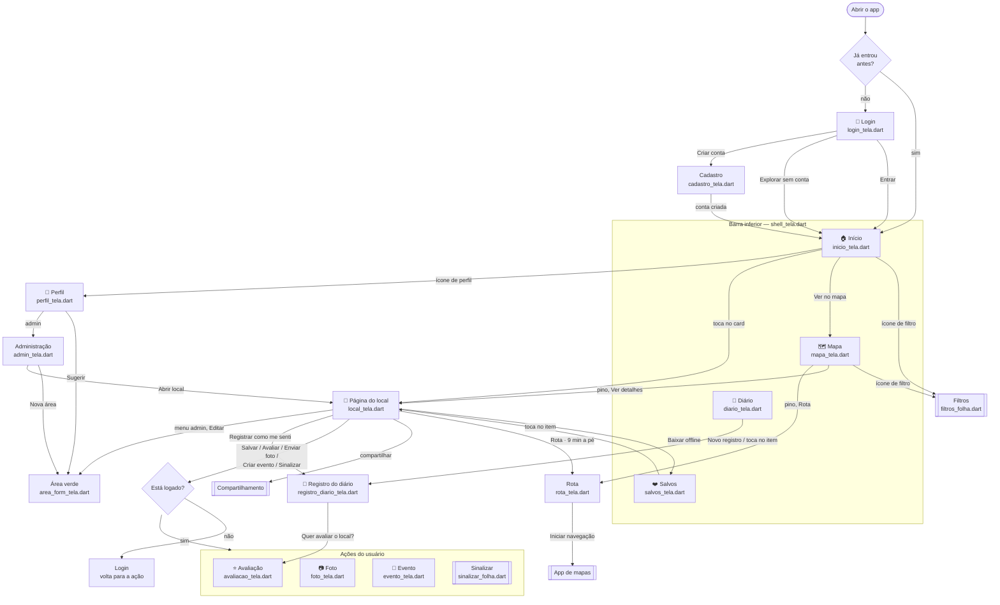
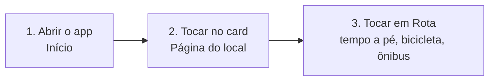

# Fluxo de Navegação — VerdeUrbano

Atende ao item **b) v**: como as telas se conectam na prática. Arquivos em `app/lib/telas/`.

## Jornada principal em 3 toques (RNF01)

Pelo mapa também são 3 toques: **aba Mapa → pino → Rota**.

## Correspondência com o protótipo de alta fidelidade

| Tela do protótipo | Arquivo |
|---|---|
| Início (feed "Que tal um respiro verde hoje?") | `inicio_tela.dart` + `widgets/area_card.dart` |
| Mapa com card do local | `mapa_tela.dart` |
| Página do local (atividades, estrutura, acessibilidade, fonte, avaliações) | `local_tela.dart` |
| Rota (a pé, bicicleta, ônibus · Iniciar navegação) | `rota_tela.dart` |
| Filtros (3 filtros selecionados · Mostrar 9 locais) | `filtros_folha.dart` |
| Salvos (Favoritos · Offline) | `salvos_tela.dart` |
| Diário de bem-estar ("Como você está depois da visita?") | `diario_tela.dart`, `registro_diario_tela.dart` |
| Guia visual (cores, Fraunces e Nunito Sans) | `core/tema.dart` |
| *Novas na Unidade II* | `login_tela`, `cadastro_tela`, `perfil_tela`, `avaliacao_tela`, `foto_tela`, `evento_tela`, `area_form_tela`, `admin_tela` |
