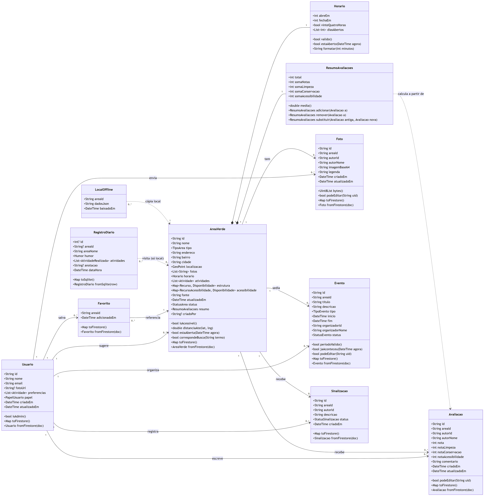
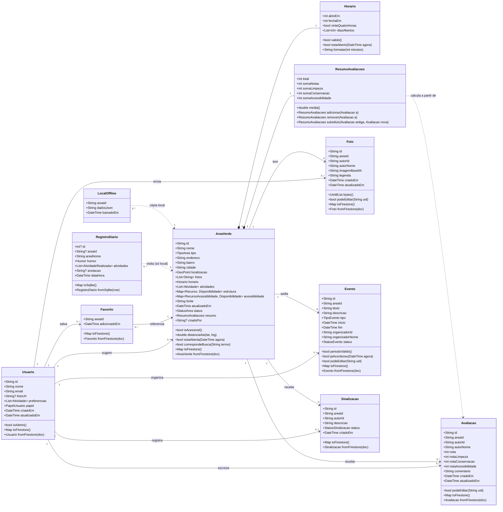

# Modelagem de Dados — VerdeUrbano

Este documento atende ao item **b) ii, iii e iv** da Unidade II: diagrama de classes (modelos de domínio), estrutura de coleções e documentos no Firebase e mapeamento das classes Dart para o Firestore.

> **Pendente:** ajustar quando o grupo receber o **aditivo de regras de negócio** do estudo de caso. Os pontos que provavelmente mudam estão marcados com ⚠️.

---

## 1. Decisões que definem a modelagem

Elas vêm do estudo de caso e dos requisitos da Unidade I. Não são escolhas técnicas soltas.

| Decisão | Origem | Consequência na modelagem |
|---|---|---|
| Mapa e locais podem ser consultados **sem login** | RNF03, estudo de caso 2.7 | A leitura de `areas_verdes` é pública. O login só é exigido para escrever. |
| Diário de bem-estar fica **somente no aparelho** | RNF04, estudo de caso 2.7 | O diário **não existe no Firestore**. Fica em banco local (SQLite). |
| Distinguir "não tem" de "ninguém informou" | RF07 | O recurso não é `bool`, é um enum de 3 estados: `tem`, `naoTem`, `naoInformado`. |
| Mostrar fonte e data de atualização | RF08 | Os campos `fonte` e `atualizadoEm` são obrigatórios em toda área verde. |
| Consulta offline de locais salvos | RF11, RF12, RNF05 | O Firestore mantém cache offline e, além disso, há uma tabela local `locais_offline`. |
| Fotos enviadas pela comunidade | CRUD 4, RF09 | A imagem é comprimida e guardada **em base64 dentro do documento**, na subcoleção `fotos`. O Firebase Storage exige o plano pago (Blaze), e a stack da disciplina é Auth + banco. Limite: 1 MiB por documento. ⚠️ Se o grupo ativar o Blaze, troca-se `imagemBase64` por uma URL do Storage. |
| Eventos e mutirões | CRUD 5 | Subcoleção `eventos` dentro da área. **O protótipo não tem tela para isso**: o grupo precisa decidir se entra no app ou se sai do escopo. |
| Exclusão de conta com anonimização | CRUD 1 (LGPD) | Avaliações e eventos ficam com o nome "Usuário removido"; fotos e favoritos são apagados (ver seção 3.3). |
| Moderação de relatos e sinalizações | Justificativas, item 8 | Papel `admin` no usuário. Sinalizações ficam numa coleção separada que só o admin altera. |

---

## 2. Diagrama de classes (modelos de domínio)



<details>
<summary>Código-fonte do diagrama (Mermaid, editável)</summary>



</details>

**Como ler:** linha cheia = relação guardada no Firestore. Linha **tracejada** = dado que fica só no celular (SQLite) ou dependência de cálculo. Losango preto = a parte vive **dentro** do documento da área (não é coleção separada).

Para regerar a imagem depois de editar: `npx @mermaid-js/mermaid-cli -i docs/diagramas/diagrama-classes.mmd -o docs/diagramas/diagrama-classes.png -b white -s 2`

### Por que cada tipo

| Tipo | Onde | Motivo |
|---|---|---|
| `String` | ids, nomes, endereço, textos | O **id de documento do Firestore é sempre texto**, assim como o uid do Firebase Auth. Não existe id numérico autoincremento como no SQL. |
| `int` | notas, somas, horário, total | **Notas são inteiras de 1 a 5**, então a soma delas também é inteira e a conta fica exata. O **horário é guardado em minutos desde a meia-noite** (06:00 = 360, 20:00 = 1200): comparar fica direto (`agora >= abreEm`), sem precisar quebrar o texto "06:00". |
| `double` | médias, distância | **São os únicos valores realmente quebrados.** A média é 996 ÷ 212 = 4,698… e é calculada só na hora de mostrar. A distância vem do GPS em metros com casas decimais. |
| `enum` | tipo, atividades, disponibilidade, humor… | No Dart é enum, o que evita digitar errado. No Firestore vira texto (ver seção 4). |
| `DateTime` | datas | No Firestore vira `Timestamp`. |
| `GeoPoint` | localização | Tipo nativo do Firestore para latitude e longitude. |

### Enums

| Enum | Valores | Usado em |
|---|---|---|
| `TipoArea` | `parque`, `praca`, `horta`, `bosque` | AreaVerde |
| `Atividade` | `caminhada`, `corrida`, `trilhas`, `playground`, `quadras`, `descanso` | AreaVerde, preferências do Usuario, filtros |
| `Recurso` | `bancos`, `banheiros`, `bebedouros`, `equipamentosEsportivos`, `estacionamento` | AreaVerde.estrutura |
| `RecursoAcessibilidade` | `rampas`, `caminhosAcessiveis`, `banheiroAdaptado`, `iluminacao` | AreaVerde.acessibilidade |
| `Disponibilidade` | `tem`, `naoTem`, `naoInformado` | estrutura e acessibilidade (RF07) |
| `StatusArea` | `publicada`, `pendente`, `desativada` | AreaVerde (sugestão de morador entra como `pendente`) |
| `PapelUsuario` | `usuario`, `admin` | Usuario (controle de acesso) ⚠️ |
| `StatusSinalizacao` | `pendente`, `resolvida`, `rejeitada` | Sinalizacao |
| `TipoEvento` | `ioga`, `grupoCorrida`, `mutiraoPlantio`, `feiraOrganica`, `outro` | Evento |
| `StatusEvento` | `agendado`, `cancelado` | Evento |
| `Humor` | `agitado`, `cansado`, `neutro`, `calmo`, `revigorado` | RegistroDiario |
| `AtividadeRealizada` | `caminhei`, `corri`, `descansei`, `brinqueiComCriancas`, `encontreiAmigos`, `observeiNatureza` | RegistroDiario |

---

## 3. Estrutura no Firestore (nuvem)

```
firestore
├── usuarios/{uid}                         ← Usuario (id = uid do Firebase Auth)
│   └── favoritos/{areaId}                 ← Favorito (id = id da área → impede duplicado)
│
├── areas_verdes/{areaId}                  ← AreaVerde (Horario e ResumoAvaliacoes vão dentro)
│   ├── avaliacoes/{uid}                   ← Avaliacao (id = uid do autor → 1 avaliação por pessoa por local)
│   ├── fotos/{fotoId}                     ← Foto da comunidade (imagem em base64)
│   └── eventos/{eventoId}                 ← Evento / mutirão
│
└── sinalizacoes/{sinalizacaoId}           ← Sinalizacao (coleção raiz: o admin modera tudo num lugar só)
```

**Por que favoritos e avaliações usam IDs fixos:** usar `areaId` como id do favorito e `uid` como id da avaliação faz o próprio banco garantir a regra de negócio. Não dá pra favoritar o mesmo local duas vezes nem avaliar o mesmo local duas vezes, sem precisar consultar antes de gravar.

**Por que o favorito só guarda o id:** a aba "Salvos" mostra nome, distância e horário (*"Parque · 650 m · aberto até 20h"*). Esses dados vêm da própria área, que o app já carregou para o mapa. Se o favorito guardasse uma cópia, ela ficaria desatualizada quando a área mudasse de horário.

**Por que avaliações guardam `autorNome`:** o perfil (`usuarios/{uid}`) só pode ser lido pelo próprio dono, por privacidade. Sem uma cópia do nome na avaliação, ninguém conseguiria ver quem escreveu "Camila R., há 3 dias".

### 3.1 Exemplos de documentos

`usuarios/aB3xK9...`
```json
{
  "nome": "Marina Alves",
  "email": "marina@email.com",
  "fotoUrl": null,
  "preferencias": ["caminhada", "descanso"],
  "papel": "usuario",
  "criadoEm": "Timestamp",
  "atualizadoEm": "Timestamp"
}
```

`areas_verdes/parque-aguas-claras`
```json
{
  "nome": "Parque das Águas Claras",
  "tipo": "parque",
  "endereco": "Rua das Palmeiras, 1200",
  "bairro": "Jardim Primavera",
  "cidade": "São Paulo",
  "localizacao": "GeoPoint(-23.5505, -46.6333)",
  "fotos": ["https://..."],
  "horario": { "abreEm": 360, "fechaEm": 1200, "vinteQuatroHoras": false, "diasAbertos": [1,2,3,4,5,6,7] },
  "atividades": ["caminhada", "corrida", "playground", "descanso"],
  "estrutura": {
    "bancos": "tem", "banheiros": "tem", "bebedouros": "tem",
    "equipamentosEsportivos": "naoTem", "estacionamento": "tem"
  },
  "acessibilidade": {
    "rampas": "tem", "caminhosAcessiveis": "tem",
    "banheiroAdaptado": "naoInformado", "iluminacao": "tem"
  },
  "fonte": "Prefeitura + 18 contribuições da comunidade",
  "atualizadoEm": "Timestamp",
  "status": "publicada",
  "criadoPor": null,
  "resumo": {
    "total": 212, "somaNotas": 996,
    "somaLimpeza": 1018, "somaConservacao": 975, "somaAcessibilidade": 912
  }
}
```

`areas_verdes/parque-aguas-claras/avaliacoes/aB3xK9...`
```json
{
  "autorId": "aB3xK9...",
  "autorNome": "Camila R.",
  "nota": 5,
  "notaLimpeza": 5, "notaConservacao": 4, "notaAcessibilidade": 4,
  "comentario": "Pista bem iluminada no fim da tarde.",
  "criadoEm": "Timestamp",
  "atualizadoEm": "Timestamp"
}
```

`areas_verdes/parque-aguas-claras/eventos/x7Qp...`
```json
{
  "titulo": "Ioga ao ar livre",
  "descricao": "Traga sua canga.",
  "tipo": "ioga",
  "inicio": "Timestamp",
  "fim": "Timestamp",
  "organizadorId": "aB3xK9...",
  "organizadorNome": "Marina A.",
  "status": "agendado"
}
```

### 3.2 Como a nota média é mantida

A tela mostra "4,7 · 212 avaliações" e as médias por critério. Ler as 212 avaliações cada vez que alguém abre o card seria lento e caro. Por isso a área guarda, no `resumo`, o **total** e a **soma** de cada nota.

Tudo acontece numa **transação**: as duas gravações dão certo juntas ou nenhuma acontece.

| Ação | Avaliação | Resumo da área |
|---|---|---|
| Avaliar | cria `avaliacoes/{uid}` | `total + 1`, cada soma `+ nota` (`adicionar`) |
| Editar nota | atualiza | tira a nota antiga e põe a nova, total igual (`substituir`) |
| Excluir | apaga | `total − 1`, cada soma `− nota` (`remover`) |

A média (`double`) é calculada só na hora de mostrar: `somaNotas / total`.

**As regras do Firestore conferem essa conta** (ver seção 6). Se o app mandar um resumo que não bate com a avaliação gravada na mesma transação, o banco recusa. Ninguém consegue inflar a nota de um local.

### 3.3 Exclusão de conta (LGPD)

Na ordem:

1. Busca todas as avaliações, fotos e eventos do usuário em todas as áreas, com uma consulta por `autorId`/`organizadorId` (*collection group query*).
2. Avaliações e eventos: troca o nome por "Usuário removido". As notas continuam valendo para a média.
3. Fotos: apaga.
4. Favoritos: apaga a subcoleção, já que o Firestore **não apaga subcoleções sozinho**.
5. Apaga `usuarios/{uid}`.
6. Apaga a conta no Firebase Auth.

---

## 4. Mapeamento Dart ↔ Firestore

Cada modelo tem `toFirestore()` (Dart → documento) e `fromFirestore()` (documento → Dart). As conversões que não são diretas:

| Tipo em Dart | Tipo no Firestore | Como converte |
|---|---|---|
| `DateTime` | `Timestamp` | `Timestamp.fromDate(d)` / `ts.toDate()` |
| `enum` (ex.: `TipoArea.parque`) | `string` (`"parque"`) | `e.name` / `enumPorNome(TipoArea.values, s, padrão)` |
| `Map<Recurso, Disponibilidade>` | `map<string, string>` | chave e valor viram `.name` |
| `GeoPoint` | `geopoint` | tipo nativo do `cloud_firestore`, sem conversão |
| `Horario`, `ResumoAvaliacoes` | `map` aninhado | objeto embutido no documento, não é coleção |
| `id` do modelo | **id do documento** | não é gravado como campo; vem de `doc.id` |
| `areaId` em Avaliacao/Foto/Evento | **caminho do documento** | não é gravado; vem de `doc.reference.parent.parent.id` |

**Por que enum vira texto e não número:** se alguém reordenar o enum no Dart, os números mudam e os dados antigos passam a significar outra coisa. Com o nome (`"parque"`), o dado continua legível no console do Firebase e não quebra com a reordenação.

**Robustez na leitura:** `fromFirestore` usa valor padrão quando um campo falta ou tem valor desconhecido (ex.: `estrutura` sem uma chave → `naoInformado`; `tipo: "shopping"` → `parque`). Assim, um documento incompleto não derruba o app. Os testes em `app/test/models_test.dart` cobrem isso.

---

## 5. Dados locais (no aparelho)

Banco SQLite (`sqflite`), arquivo `verde_urbano.db`. Nada daqui vai para a nuvem.

```sql
-- RNF04: o diário de bem-estar nunca sai do aparelho
CREATE TABLE registros_diario (
  id          INTEGER PRIMARY KEY AUTOINCREMENT,
  area_id     TEXT,                -- opcional: o registro pode ser de um local fora do app
  area_nome   TEXT NOT NULL,
  humor       TEXT NOT NULL,       -- agitado | cansado | neutro | calmo | revigorado
  atividades  TEXT NOT NULL,       -- lista separada por vírgula (SQLite não tem tipo lista)
  anotacao    TEXT,
  data_hora   TEXT NOT NULL        -- ISO 8601
);

-- RF11/RF12: cópia dos dados essenciais para consulta sem internet
CREATE TABLE locais_offline (
  area_id     TEXT PRIMARY KEY,
  dados_json  TEXT NOT NULL,       -- AreaVerde serializada (SQLite não tem tipo objeto)
  baixado_em  TEXT NOT NULL        -- exibido como "atualizado em" (RF12)
);
```

O CRUD do diário fica completo e local: criar registro, listar, editar e excluir.

---

## 6. Regras de segurança

Arquivo completo em [`app/firestore.rules`](../app/firestore.rules). **Testadas** no emulador oficial do Firebase com 39 casos, incluindo tentativas de fraude ([`app/firestore-tests/`](../app/firestore-tests/regras.test.js)).

| Coleção | Ler | Criar | Editar | Excluir |
|---|---|---|---|---|
| `usuarios/{uid}` | dono ou admin | dono, com `papel = usuario` | dono, **sem alterar `papel`** | dono |
| `…/favoritos/{areaId}` | dono | dono, se a área existir | — | dono |
| `areas_verdes` | **qualquer um** se `publicada`; quem sugeriu vê a própria pendente | logado → `pendente` e sem avaliações; admin → livre | admin; usuário logado só o `resumo`, **e só com a conta certa** | admin |
| `…/avaliacoes/{uid}` | qualquer um | dono, notas de 1 a 5, comentário até 500 caracteres, **junto com o resumo** | dono; se mudou nota, o resumo muda junto | dono ou admin, com o resumo caindo junto |
| `…/fotos` | qualquer um | logado, até ~700 KB | só o autor | autor ou admin |
| `…/eventos` | qualquer um | logado, **no futuro**, fim depois do início | só o organizador | organizador ou admin |
| `sinalizacoes` | admin ou o autor | logado, `pendente`, área existente | admin | admin |

**Controle de acesso:** um usuário não consegue se promover a admin, porque a regra bloqueia qualquer escrita no campo `papel`. O papel de admin é atribuído manualmente pelo console do Firebase. ⚠️ *O aditivo pode definir outros papéis.*

**Validação na regra, não só na tela:** limites de nota, tamanho de texto e data de evento são verificados **no banco**. Validar só na tela não protege, porque alguém pode chamar a API do Firebase direto, sem passar pelo app.

---

## 7. Limitações conhecidas (decisões conscientes)

| Limitação | Por quê | Saída se o projeto crescer |
|---|---|---|
| Busca por nome/bairro/cidade (RF13) e "locais a até 3 km" são filtrados **no aparelho** | O Firestore não tem busca por "contém" nem consulta por raio. Com dezenas de áreas, carregar todas e filtrar no celular é rápido e funciona offline. | Campo `geohash` + biblioteca de consulta por raio; serviço de busca (Algolia/Typesense). |
| Fotos em base64 limitadas a ~700 KB | Firebase Storage exige o plano pago | Ativar o Blaze e trocar por URL do Storage |
| Mapa offline guarda os **dados** dos locais, não as imagens do mapa (tiles) | Baixar tiles do OpenStreetMap em massa viola a política de uso deles | Provedor de tiles com licença para cache offline |

---

## 8. Rastreabilidade com os requisitos

| Requisito | Onde está no modelo |
|---|---|
| RF01, RF02 | `AreaVerde.localizacao` + `distanciaAte()` |
| RF04, RF05 | `AreaVerde.atividades`, `AreaVerde.estrutura` |
| RF06 | `fotos`, `endereco`, `horario`, `atividades`, `estrutura` |
| RF07, RNF08 | `acessibilidade` com `Disponibilidade` de 3 estados |
| RF08 | `fonte`, `atualizadoEm` |
| RF09 | subcoleções `avaliacoes` e `fotos` + `resumo` |
| RF10 | coleção `sinalizacoes` |
| RF11, RF12 | tabela local `locais_offline` + cache do Firestore |
| RF13 | `correspondeBusca()` sobre `nome`, `bairro`, `cidade` |
| RF14–RF16 | subcoleção `usuarios/{uid}/favoritos` |
| RNF03 | leitura pública de `areas_verdes` |
| RNF04 | tabela local `registros_diario` |
| CRUD 1–6 (Unidade I) | Usuario, AreaVerde, Avaliacao, Foto, Evento, Favorito |
