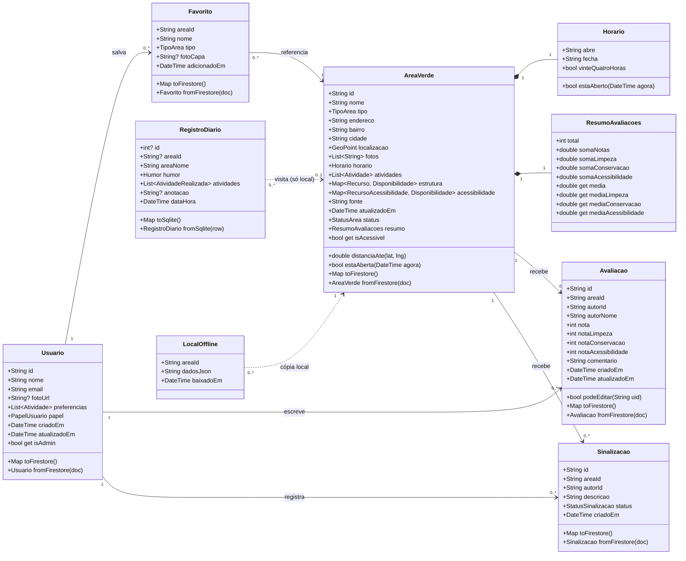

# Modelagem de Dados — VerdeUrbano

Este documento atende ao item **b) ii, iii e iv** da Unidade II: diagrama de classes (modelos de domínio), estrutura de coleções e documentos no Firebase e mapeamento das classes Dart para o Firestore.

> **Pendente:** ajustar quando o grupo receber o **aditivo de regras de negócio** do estudo de caso. Os pontos que provavelmente mudam estão marcados com ⚠️.

---

## 1. Decisões que definem a modelagem

Elas vêm do estudo de caso e dos requisitos da Unidade I. Não são escolhas técnicas soltas.

| Decisão | Origem | Consequência na modelagem |
|---|---|---|
| Mapa e locais podem ser consultados **sem login** | RNF03, estudo de caso 2.7 | A leitura de `areas_verdes` é pública. O login só é exigido para escrever. |
| Diário de bem-estar fica **somente no aparelho** | RNF04, estudo de caso 2.7 | O diário **não existe no Firestore**. Fica em banco local (SQLite). |
| Distinguir "não tem" de "ninguém informou" | RF07 | O recurso não é `bool`, é um enum de 3 estados: `tem`, `naoTem`, `naoInformado`. |
| Mostrar fonte e data de atualização | RF08 | Os campos `fonte` e `atualizadoEm` são obrigatórios em toda área verde. |
| Consulta offline de locais salvos | RF11, RF12, RNF05 | O Firestore mantém cache offline e, além disso, há uma tabela local `locais_offline`. |
| Exclusão de conta com anonimização | CRUD "Perfil" (LGPD) | Avaliações guardam `autorId` e `autorNome`. Ao excluir a conta, o nome vira "Usuário removido". |
| Moderação de relatos e sinalizações | Justificativas, item 8 | Papel `admin` no usuário. Sinalizações ficam numa coleção separada que só o admin altera. |

---

## 2. Diagrama de classes (modelos de domínio)


<details>
<summary>Código-fonte do diagrama (Mermaid, editável)</summary>



</details>

Para regerar a imagem depois de editar: `npx @mermaid-js/mermaid-cli -i docs/diagramas/diagrama-classes.mmd -o docs/diagramas/diagrama-classes.png -b white -s 2`

### Enums

| Enum | Valores | Usado em |
|---|---|---|
| `TipoArea` | `parque`, `praca`, `horta`, `bosque` | AreaVerde |
| `Atividade` | `caminhada`, `corrida`, `trilhas`, `playground`, `quadras`, `descanso` | AreaVerde, preferências do Usuario, filtros |
| `Recurso` | `bancos`, `banheiros`, `bebedouros`, `equipamentosEsportivos`, `estacionamento` | AreaVerde.estrutura |
| `RecursoAcessibilidade` | `rampas`, `caminhosAcessiveis`, `banheiroAdaptado`, `iluminacao` | AreaVerde.acessibilidade |
| `Disponibilidade` | `tem`, `naoTem`, `naoInformado` | estrutura e acessibilidade (RF07) |
| `StatusArea` | `publicada`, `pendente`, `desativada` | AreaVerde (sugestão de morador entra como `pendente`) |
| `PapelUsuario` | `usuario`, `admin` | Usuario (controle de acesso) ⚠️ |
| `StatusSinalizacao` | `pendente`, `resolvida`, `rejeitada` | Sinalizacao |
| `Humor` | `agitado`, `cansado`, `neutro`, `calmo`, `revigorado` | RegistroDiario |
| `AtividadeRealizada` | `caminhei`, `corri`, `descansei`, `brinqueiComCriancas`, `encontreiAmigos`, `observeiNatureza` | RegistroDiario |

---

## 3. Estrutura no Firestore (nuvem)

```
firestore
├── usuarios/{uid}                         ← Usuario (id = uid do Firebase Auth)
│   └── favoritos/{areaId}                 ← Favorito (id = id da área → impede duplicado)
│
├── areas_verdes/{areaId}                  ← AreaVerde
│   └── avaliacoes/{uid}                   ← Avaliacao (id = uid do autor → 1 avaliação por pessoa por local)
│
└── sinalizacoes/{sinalizacaoId}           ← Sinalizacao (coleção raiz: o admin modera tudo num lugar só)
```

**Por que favoritos e avaliações usam IDs determinísticos:** usar `areaId` como id do favorito e `uid` como id da avaliação faz o próprio banco garantir a regra de negócio. Não dá pra favoritar o mesmo local duas vezes nem avaliar o mesmo local duas vezes, sem precisar consultar antes de gravar.

### 3.1 Exemplos de documentos

`usuarios/aB3xK9...`
```json
{
  "nome": "Marina Alves",
  "email": "marina@email.com",
  "fotoUrl": null,
  "preferencias": ["caminhada", "descanso"],
  "papel": "usuario",
  "criadoEm": "Timestamp",
  "atualizadoEm": "Timestamp"
}
```

`areas_verdes/parque-aguas-claras`
```json
{
  "nome": "Parque das Águas Claras",
  "tipo": "parque",
  "endereco": "Rua das Palmeiras, 1200",
  "bairro": "Jardim Primavera",
  "cidade": "São Paulo",
  "localizacao": "GeoPoint(-23.5505, -46.6333)",
  "fotos": ["https://..."],
  "horario": { "abre": "06:00", "fecha": "20:00", "vinteQuatroHoras": false },
  "atividades": ["caminhada", "corrida", "playground", "descanso"],
  "estrutura": {
    "bancos": "tem", "banheiros": "tem", "bebedouros": "tem",
    "equipamentosEsportivos": "naoTem", "estacionamento": "tem"
  },
  "acessibilidade": {
    "rampas": "tem", "caminhosAcessiveis": "tem",
    "banheiroAdaptado": "naoInformado", "iluminacao": "tem"
  },
  "fonte": "Prefeitura + 18 contribuições da comunidade",
  "atualizadoEm": "Timestamp",
  "status": "publicada",
  "resumo": {
    "total": 212, "somaNotas": 996.4,
    "somaLimpeza": 1017.6, "somaConservacao": 975.2, "somaAcessibilidade": 911.6
  }
}
```

`areas_verdes/parque-aguas-claras/avaliacoes/aB3xK9...`
```json
{
  "autorId": "aB3xK9...",
  "autorNome": "Camila R.",
  "nota": 5,
  "notaLimpeza": 5, "notaConservacao": 4, "notaAcessibilidade": 4,
  "comentario": "Pista bem iluminada no fim da tarde.",
  "criadoEm": "Timestamp",
  "atualizadoEm": "Timestamp"
}
```

**Por que `resumo` guarda somas e não médias:** a tela mostra "4,7 · 212 avaliações" e as médias por critério (Limpeza 4,8, Conservação 4,6...). Calcular isso lendo as 212 avaliações toda vez que alguém abre o card seria lento e caro. Guardando a **soma** e o **total**, uma avaliação nova só soma o valor dela e incrementa o total, numa **transação** junto com a gravação da avaliação. A média é calculada na hora (`soma / total`). Editar ou excluir uma avaliação aplica a diferença.

---

## 4. Mapeamento Dart ↔ Firestore

Cada modelo tem `toFirestore()` (Dart → documento) e `fromFirestore()` (documento → Dart). As conversões que não são diretas:

| Tipo em Dart | Tipo no Firestore | Como converte |
|---|---|---|
| `DateTime` | `Timestamp` | `Timestamp.fromDate(d)` / `ts.toDate()` |
| `enum` (ex.: `TipoArea.parque`) | `string` (`"parque"`) | `e.name` / `TipoArea.values.byName(s)` |
| `Map<Recurso, Disponibilidade>` | `map<string, string>` | chave e valor viram `.name` |
| `GeoPoint` | `geopoint` | tipo nativo do `cloud_firestore`, sem conversão |
| `Horario`, `ResumoAvaliacoes` | `map` aninhado | objeto embutido no documento, não é coleção |
| `id` do modelo | **id do documento** | não é gravado como campo; vem de `doc.id` |

**Por que enum vira string e não número:** se alguém reordenar o enum no Dart, os números mudam e os dados antigos passam a significar outra coisa. Com o nome (`"parque"`), o dado continua legível no console do Firebase e não quebra com a reordenação.

**Robustez na leitura:** `fromFirestore` usa valor padrão quando um campo falta (ex.: `estrutura` sem uma chave → `naoInformado`). Assim, um documento antigo ou incompleto não derruba o app, o que se encaixa com o RF07 ("não informado" é um estado válido).

---

## 5. Dados locais (no aparelho)

Banco SQLite (`sqflite`), arquivo `verde_urbano.db`. Nada daqui vai para a nuvem.

```sql
-- RNF04: o diário de bem-estar nunca sai do aparelho
CREATE TABLE registros_diario (
  id          INTEGER PRIMARY KEY AUTOINCREMENT,
  area_id     TEXT,                -- opcional: o registro pode ser de um local fora do app
  area_nome   TEXT NOT NULL,
  humor       TEXT NOT NULL,       -- agitado | cansado | neutro | calmo | revigorado
  atividades  TEXT NOT NULL,       -- lista separada por vírgula
  anotacao    TEXT,
  data_hora   TEXT NOT NULL        -- ISO 8601
);

-- RF11/RF12: cópia dos dados essenciais para consulta sem internet
CREATE TABLE locais_offline (
  area_id     TEXT PRIMARY KEY,
  dados_json  TEXT NOT NULL,       -- AreaVerde serializada
  baixado_em  TEXT NOT NULL        -- exibido como "atualizado em" (RF12)
);
```

O CRUD do diário fica completo e local: criar registro, listar, editar e excluir.

---

## 6. Regras de segurança (resumo)

O arquivo completo está em [`app/firestore.rules`](../app/firestore.rules).

| Coleção | Ler | Criar | Editar | Excluir |
|---|---|---|---|---|
| `usuarios/{uid}` | só o dono | só o dono, com `papel = usuario` | só o dono, **sem alterar `papel`** | só o dono |
| `usuarios/{uid}/favoritos` | só o dono | só o dono | — | só o dono |
| `areas_verdes` | **qualquer um, sem login** (só `publicada`) | logado → entra como `pendente`; admin → livre | admin; usuário logado só o `resumo` | admin |
| `areas_verdes/*/avaliacoes/{uid}` | qualquer um | logado, id = próprio uid, nota de 1 a 5 | só o autor | autor ou admin |
| `sinalizacoes` | admin | logado | admin (moderação) | admin |

**Controle de acesso:** um usuário não consegue se promover a admin, porque a regra bloqueia qualquer escrita no campo `papel`. O papel de admin é atribuído manualmente pelo console do Firebase. ⚠️ *O aditivo pode definir outros papéis.*

**Limitação conhecida:** a regra permite que usuário logado altere `resumo` (para a transação da avaliação funcionar no plano gratuito, sem Cloud Functions), mas não consegue validar se a conta está certa. Em produção isso iria para uma Cloud Function. Para o escopo da disciplina, fica documentado como decisão consciente.

---

## 7. Rastreabilidade com os requisitos

| Requisito | Onde está no modelo |
|---|---|
| RF01, RF02 | `AreaVerde.localizacao` + `distanciaAte()` |
| RF04, RF05 | `AreaVerde.atividades`, `AreaVerde.estrutura` |
| RF06 | `fotos`, `endereco`, `horario`, `atividades`, `estrutura` |
| RF07, RNF08 | `acessibilidade` com `Disponibilidade` de 3 estados |
| RF08 | `fonte`, `atualizadoEm` |
| RF09 | subcoleção `avaliacoes` + `resumo` |
| RF10 | coleção `sinalizacoes` |
| RF11, RF12 | tabela local `locais_offline` + cache do Firestore |
| RF13 | `nome`, `bairro`, `cidade` |
| RF14–RF16 | subcoleção `usuarios/{uid}/favoritos` |
| RNF03 | leitura pública de `areas_verdes` |
| RNF04 | tabela local `registros_diario` |
