# Planejamento do Projeto — VerdeUrbano (Unidade II)

Atende ao item **d)**: escopo, EAP simplificada e planejamento em sprints.
Base: estudo de caso, requisitos (RF01–RF17, RNF01–RNF08), CRUDs 1–6 e personas
(Marina Alves é a persona prioritária; Sr. Antônio orienta acessibilidade e leitura fácil).

**Datas:** apresentações em **03/12/2026** e **10/12/2026** · entrega pelo link do repositório no Teams.

---

## 1. Escopo

**Objetivo:** app mobile em **Dart + Flutter + Firebase (Authentication e Cloud Firestore)** para
encontrar áreas verdes urbanas, decidir se o local serve para a visita e chegar até ele em até
3 toques.

### Dentro do escopo

| # | Entrega | Requisitos |
|---|---|---|
| E1 | Login, cadastro, recuperar senha, perfil e exclusão de conta | CRUD 1, RNF03, LGPD |
| E2 | Início com distância, nota, horário e selo "Acessível" | RF01, RF02, RF06 |
| E3 | Mapa (OpenStreetMap) com pinos e card do local | RF01, RF02 |
| E4 | Busca por nome/bairro/cidade e filtros (atividade, estrutura, acessibilidade, distância) | RF04, RF05, RF13 |
| E5 | Página do local: estrutura e acessibilidade em 3 estados, fonte e data | RF06, RF07, RF08, RNF08 |
| E6 | Rota com tempo a pé, bicicleta e ônibus + navegação no app de mapas; compartilhar | RF03, RF17, RNF01 |
| E7 | Avaliações com média mantida por transação | CRUD 3, RF09 |
| E8 | Fotos da comunidade (base64 no Firestore) | CRUD 4, RF09 |
| E9 | Eventos e mutirões | CRUD 5 |
| E10 | Favoritos sincronizados | CRUD 6, RF14–RF16 |
| E11 | Sinalização de informação incorreta + moderação | RF10 |
| E12 | Cópia offline dos locais (SQLite) + cache do Firestore | RF11, RF12, RNF05, RNF06 |
| E13 | Diário de bem-estar 100% local (SQLite) | RNF04 |
| E14 | Área do administrador: CRUD de áreas, aprovação de sugestões | CRUD 2 |
| E15 | Regras de segurança, validações e tratamento de falhas de conexão | item a.iv |
| E16 | Documentação técnica em `/docs` | item b |

### Fora do escopo (próximas versões)

- **Firebase Storage** para fotos: exige o plano pago (Blaze). Nesta versão as fotos ficam em base64, até ~700 KB.
- **Blocos do mapa offline**: a política do OpenStreetMap não permite baixar tiles em massa. Salvamos os *dados* do local.
- **Rota desenhada dentro do app**: a navegação é delegada ao app de mapas do aparelho; a tela Rota mostra a estimativa.
- Notificações de eventos e publicação nas lojas.

### Premissas e restrições

- Stack obrigatória: Dart, Flutter e Firebase. O app precisa compilar e rodar no emulador ou aparelho.
- Uso de IA documentado em `docs/uso-de-ia.md`.
- Nota individual pelos commits de cada conta: cada integrante commita o que fez.

---

## 2. EAP simplificada

```mermaid
flowchart TD
    P[VerdeUrbano<br/>Unidade II]

    P --> G[1. Gestão]
    P --> D[2. Documentação técnica]
    P --> B[3. Firebase]
    P --> F[4. App Flutter]
    P --> Q[5. Qualidade e entrega]

    G --> G1[1.1 Escopo, EAP e sprints]
    G --> G2[1.2 README e CHANGELOG]
    G --> G3[1.3 Checkpoints semanais]

    D --> D1[2.1 Casos de uso]
    D --> D2[2.2 Diagrama de classes]
    D --> D3[2.3 Modelagem Firestore e mapeamento Dart]
    D --> D4[2.4 Fluxo de navegação]
    D --> D5[2.5 Registro de uso de IA]

    B --> B1[3.1 Projeto Firebase e flutterfire]
    B --> B2[3.2 Authentication]
    B --> B3[3.3 Regras e índices]
    B --> B4[3.4 Dados de exemplo]

    F --> F1[4.1 Modelos e banco local]
    F --> F2[4.2 Login, cadastro e perfil]
    F --> F3[4.3 Início, filtros e mapa]
    F --> F4[4.4 Página do local e rota]
    F --> F5[4.5 Avaliações, fotos e eventos]
    F --> F6[4.6 Salvos e offline]
    F --> F7[4.7 Diário de bem-estar]
    F --> F8[4.8 Administração]

    Q --> Q1[5.1 Testes automatizados]
    Q --> Q2[5.2 Testes no emulador]
    Q --> Q3[5.3 Correção de bugs]
    Q --> Q4[5.4 Apresentação e arguição]
```

---

## 3. Sprints (1 semana cada)

| Sprint | Período | Meta | Itens da EAP | Entregável no checkpoint |
|---|---|---|---|---|
| **S1** | 05/11 – 11/11 | Base do projeto | 1.1, 2.2, 2.3, 3.3, 4.1 | Modelos, regras do Firestore testadas, SQLite, modelagem de dados |
| **S2** | 12/11 – 18/11 | Telas do protótipo e Firebase ligado | 3.1, 3.2, 3.4, 4.2–4.4, 2.1, 2.4 | Login real, Início, Mapa, Filtros, Local e Rota rodando no emulador |
| **S3** | 19/11 – 25/11 | CRUDs e uso offline | 4.5–4.8, 2.5 | Avaliações, fotos, eventos, favoritos, offline, diário e admin |
| **S4** | 26/11 – 02/12 | Estabilização | 5.1–5.3, 1.2 | Testes, correções, README e CHANGELOG finais |
| — | **03/12** | Apresentação 1 | 5.4 | Demonstração no emulador |
| **S5** | 03/12 – 09/12 | Ajustes da banca | 5.3 | Correções pedidas na apresentação |
| — | **10/12** | Apresentação final | 5.4 | Arguição |

### Frentes de trabalho

> Preencher com quem **realmente** fez cada parte e manter igual ao README.

| Frente | Arquivos principais | Responsável |
|---|---|---|
| Modelagem, regras e testes de regras | `models/`, `firestore.rules`, `firestore-tests/`, `docs/modelagem-dados.md` | |
| Autenticação e perfil | `estado/sessao.dart`, `telas/login_tela.dart`, `cadastro_tela.dart`, `perfil_tela.dart` | |
| Telas do protótipo (Início, Mapa, Local, Rota, Filtros) | `telas/inicio_tela.dart`, `mapa_tela.dart`, `local_tela.dart`, `rota_tela.dart`, `filtros_folha.dart`, `widgets/` | |
| CRUDs de comunidade (avaliações, fotos, eventos, sinalizações) | `data/*_repositorio.dart`, `telas/avaliacao_tela.dart`, `foto_tela.dart`, `evento_tela.dart` | |
| Salvos, offline e diário | `data/offline_repositorio.dart`, `data/diario_repositorio.dart`, `telas/salvos_tela.dart`, `diario_tela.dart` | |
| Administração e documentação | `telas/admin_tela.dart`, `area_form_tela.dart`, `docs/`, README, CHANGELOG | |
